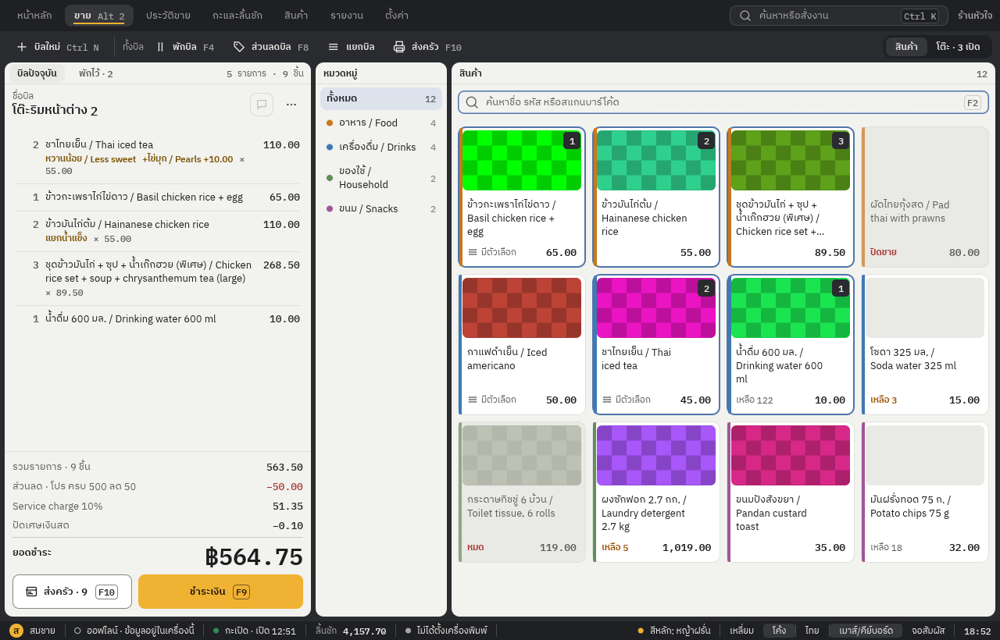

# POS Heart

POS Heart เป็นแอปขายหน้าร้านสำหรับร้านค้าทั่วไปและร้านอาหาร ออกแบบให้ใช้งานที่เคาน์เตอร์ได้ทั้งเมาส์ คีย์บอร์ด และจอสัมผัส รองรับภาษาไทยและ English พัฒนาด้วย Rust และ egui โดยเก็บข้อมูลหลักใน SQLite บนเครื่อง

**สถานะ: อยู่ระหว่างพัฒนา ยังไม่พร้อมนำไปแทนระบบขายจริง** การทดสอบอุปกรณ์จริง ความพร้อมใช้งานหลายเครื่อง และเอกสารภาษียังต้องตรวจสอบเพิ่มเติม ดูหลักฐานและข้อจำกัดใน [validation](docs/validation.md)



*หน้าจอตัวอย่างจากชุดภาพที่สร้างด้วยข้อมูลสมมติ ดูภาพและเงื่อนไขการจัดทำเพิ่มเติมใน [screenshot catalog](screenshots/2026-10-14/README.md)*

## ความสามารถ

- **ขายหน้าร้าน:** สินค้าและตัวเลือก ส่วนลด โปรโมชั่น พักบิล แยกบิล และรับชำระเงินสด โอน หรือบัตร รวมถึงแบ่งชำระหลายวิธี
- **จัดการร้านอาหาร:** ผังโต๊ะ ส่งรายการเข้าครัว ติดตามรายการ และพิมพ์ใบเช็กบิล
- **สินค้าและสต็อก:** หมวดหมู่ รูปสินค้า นำเข้า CSV ประวัติปรับสต็อก วัตถุดิบและสูตร รวมถึงใบสั่งซื้อและรับสินค้า
- **หลังการขาย:** ประวัติใบเสร็จ คืนสินค้าบางส่วนหรือยกเลิกทั้งบิล กะและลิ้นชักเงิน รายงานและส่งออก CSV
- **การตั้งค่า:** พนักงานและสิทธิ์ ภาษีมูลค่าเพิ่ม ใบกำกับภาษี ใบลดหนี้ เครื่องพิมพ์ และสำรองข้อมูล
- **อุปกรณ์และคลาวด์:** มีส่วนสำหรับเชื่อมอุปกรณ์บน LAN และบริการคลาวด์แบบเลือกใช้ อ่านสถานะและข้อจำกัดใน [multi-device](docs/multi-device.md)

การโอนและบัตรเป็นการบันทึกที่พนักงานยืนยันเอง แอปไม่ได้ตรวจสอบเงินเข้า หักเงิน หรือคืนเงินผ่านผู้ให้บริการชำระเงินโดยอัตโนมัติ เอกสารภาษียังไม่ได้รับการยืนยันรูปแบบทางกฎหมาย

## เริ่มใช้งานจากซอร์ส

ต้องมี Rust stable **1.95 ขึ้นไป** และเครื่องมือ build ของระบบ: Xcode Command Line Tools บน macOS หรือ Visual Studio C++ Build Tools บน Windows การ build ครั้งแรกต้องดาวน์โหลด dependencies; แอปเดสก์ท็อปแบบเครื่องเดียวไม่ต้องติดตั้ง database server

```sh
# เปิดด้วยข้อมูลตัวอย่างในโฟลเดอร์ demo แยกจากข้อมูลร้าน
cargo run -p pos-desktop --bin pos-heart -- --demo

# เปิดตามปกติ หรือกำหนดโฟลเดอร์ข้อมูลเอง
cargo run -p pos-desktop --bin pos-heart
cargo run -p pos-desktop --bin pos-heart -- --data-dir ./data
```

ครั้งแรกสามารถตั้งชื่อร้านและเพิ่มสินค้า หรือเลือกตั้งค่าภายหลังได้ เปิดกะก่อนรับชำระเงิน ข้อมูลปกติอยู่ในโฟลเดอร์ application data ของระบบ และดูตำแหน่งได้จาก Settings → Data & backup รายละเอียดการติดตั้งและสร้างตัวติดตั้งอยู่ใน [release guide](docs/release.md); ตัวติดตั้งยังไม่มีการลงนามอย่างสมบูรณ์

## โครงสร้างโปรเจกต์

| ส่วน | หน้าที่ |
| --- | --- |
| [`apps/pos-desktop`](apps/pos-desktop) | แอปเดสก์ท็อป UI และงานเบื้องหลัง |
| [`crates/pos-domain`](crates/pos-domain) | กฎธุรกิจ การคำนวณราคาและข้อมูลการขาย |
| [`crates/pos-core`](crates/pos-core) | ฐานข้อมูล ธุรกรรม และการจัดเก็บข้อมูล |
| [`crates/pos-service`](crates/pos-service) | โปรโตคอลและตัว dispatch คำสั่ง |
| [`crates/pos-hub`](crates/pos-hub) | การเชื่อมต่ออุปกรณ์ภายในร้าน |
| [`apps/pos-cloud`](apps/pos-cloud) | บริการคลาวด์และแดชบอร์ดแบบเลือกใช้ |
| [`design`](design) | design system, tokens และภาพอ้างอิง |

แอปเครื่องเดียวเก็บข้อมูลในเครื่องโดยปริยาย ส่วน LAN และคลาวด์ต้องตั้งค่าเพิ่มเติม ดูแนวทางและคำสั่งสำหรับบริการคลาวด์ใน [multi-device](docs/multi-device.md) และ [CLAUDE.md](CLAUDE.md)

## Checks

```sh
cargo fmt --all -- --check
cargo clippy --workspace --all-targets -- -D warnings
cargo test --workspace
```

การทดสอบบางส่วนของคลาวด์ต้องมี PostgreSQL และตัวแปร `POS_CLOUD_TEST_DATABASE_URL` ตาม [คำสั่งสำหรับนักพัฒนา](CLAUDE.md#commands) ผล build หรือภาพตัวอย่างเพียงอย่างเดียวไม่ได้ยืนยันการใช้งานจริงบนทุกแพลตฟอร์มหรืออุปกรณ์

## เอกสารเพิ่มเติม

- [คู่มือรายละเอียดและขั้นตอนใช้งาน](docs/user-guide.md) — รวมบันทึกจากช่วงพัฒนา บางหัวข้ออธิบายสถานะในอดีต
- [ขอบเขตผลิตภัณฑ์](PRODUCT.md) · [สถาปัตยกรรม](docs/architecture.md) · [ระบบดีไซน์](design/README.md)
- [อุปกรณ์หลายเครื่องและคลาวด์](docs/multi-device.md) · [การติดตั้งและ release](docs/release.md) · [ผลการตรวจสอบ](docs/validation.md)
- [แนวทางทำงานใน repository](AGENTS.md) · [คำสั่งและบริบทสำหรับนักพัฒนา](CLAUDE.md)

## ข้อมูลและสิทธิ์ใช้งาน

ใช้ข้อมูลสมมติในการพัฒนาและภาพตัวอย่าง อย่า commit ฐานข้อมูลร้าน ไฟล์สำรอง credentials หรือการตั้งค่าเฉพาะเครื่อง ฐานข้อมูลในเครื่องไม่ได้เข้ารหัส PIN พนักงานไม่ได้ป้องกันการเข้าถึงไฟล์ฐานข้อมูลโดยตรง

โปรเจกต์ยังไม่ได้เลือก license สำหรับซอร์สโค้ด ส่วนฟอนต์ที่รวมมาใช้ license ของฟอนต์แต่ละชุดใน [`assets/fonts`](assets/fonts)
